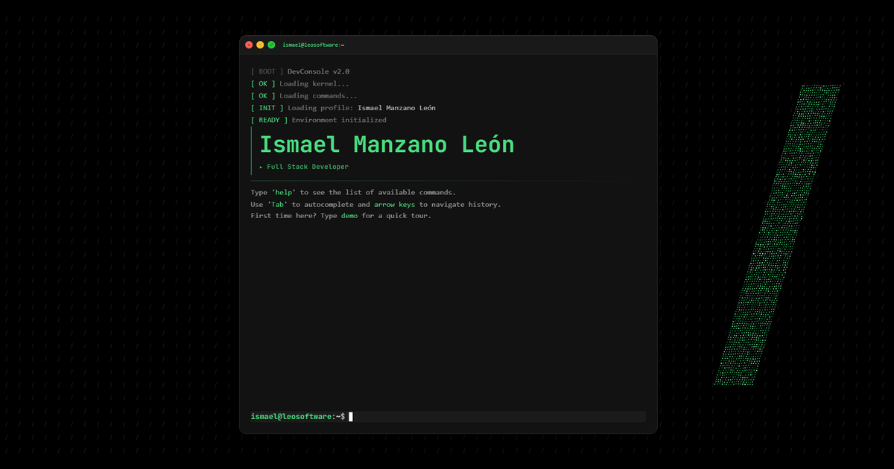

# DevConsole

My portfolio as a terminal in the browser. Each command opens a section of my profile: who I am, projects, experience, education, skills, contact and CV. Live at **[console.leosoftware.dev](https://console.leosoftware.dev)**.



It's built for technical readers: the terminal itself is the proof of how I work. The full profile, with case studies, is at [leosoftware.dev](https://leosoftware.dev).

## Commands

| Command | Shows |
|---|---|
| `about` | Who I am and what I'm looking for |
| `projects` | Projects, with status and links |
| `experience` | Where I've worked and what I did |
| `education` | Training and certifications |
| `skills` | Technologies I use |
| `contact` | Email, LinkedIn and GitHub |
| `cv` | My CV, viewable and downloadable |
| `neofetch` | System and author info |
| `lang <en\|es>` | Switch language |
| `demo` | Guided tour of the console |
| `help` | Command list |
| `clear` | Clear the screen (also `Ctrl+L`) |
| `exit` / `leo/` | Back to leosoftware.dev |

**Keyboard:** `Tab` or `→` autocompletes, `↑` / `↓` browse history, `Esc` closes a window or stops the demo.

## How it's built

- **Logic apart from the interface.** Everything that happens when you type a command lives in `src/composables/useTerminal.js`. The components only render what they're given, so the interface can change without touching the commands.
- **Autocomplete** with ghost text: a prefix search over the command list (`src/constants/commands.js`).
- **Two languages without reloading.** Texts live in `public/content.json` and in each section component; the choice is remembered in the browser.
- **Sections on demand.** Each window is an async component, loaded only when opened.
- **A real window on desktop:** drag, resize from any edge, maximize and minimize. On mobile, a card layout instead of the terminal.
- **Background** shared with leosoftware.dev: a pattern of tiny slashes and the leo/ slash made of particles (canvas 2D). It stays faint and still on mobile and pauses when the tab is hidden.
- **Analytics only with consent.** Google Analytics loads only if `VITE_GA_ID` is set and the visitor accepts.

## Stack

Vue 3 (Composition API) · Vite 7 · Tailwind CSS 4 · Typed.js (demo) · vue-pdf-embed (CV) · Lucide icons

## Run locally

```bash
git clone https://github.com/manzzaano/DevConsole.git
cd DevConsole
npm install
npm run dev        # http://localhost:5173
npm run build      # production build in dist/
```

## Deploy

Deployed on Vercel with the CLI from the project folder:

```bash
npx vercel deploy --prod
```

---

Built by [Ismael Manzano León](https://leosoftware.dev) · [LinkedIn](https://www.linkedin.com/in/ismael-manzano-leon/)
